# Hivescape

Living backgrounds that stay out of the way. From the Hivemind family.

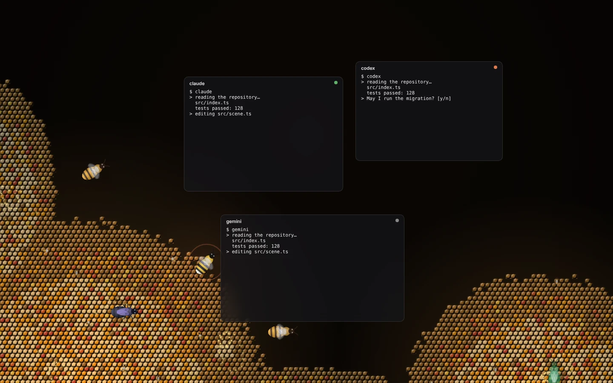

Hivescape is an animation engine for scenes that run behind other things: a desktop, a terminal
canvas, a web page. A scene paints what is there in plain canvas calls and says what gives off
light. Hivescape shows it in a style of your choosing, lights it, moves it at a calm, fixed rate,
and keeps its cost low enough to run all day.

Its own style is **comb**: the picture becomes a honeycomb of raised hexagonal cells, each bevelled
and lit. Three lights shade the cells:

- a key light from the upper left;
- the scene's own lights (a fire, a lantern, the moon), from the side each one shines from;
- the pointer, which works as a torch you move across the relief.

A click sends a swell through the cells and lifts them as it passes.

| Night | Dusk |
|---|---|
| 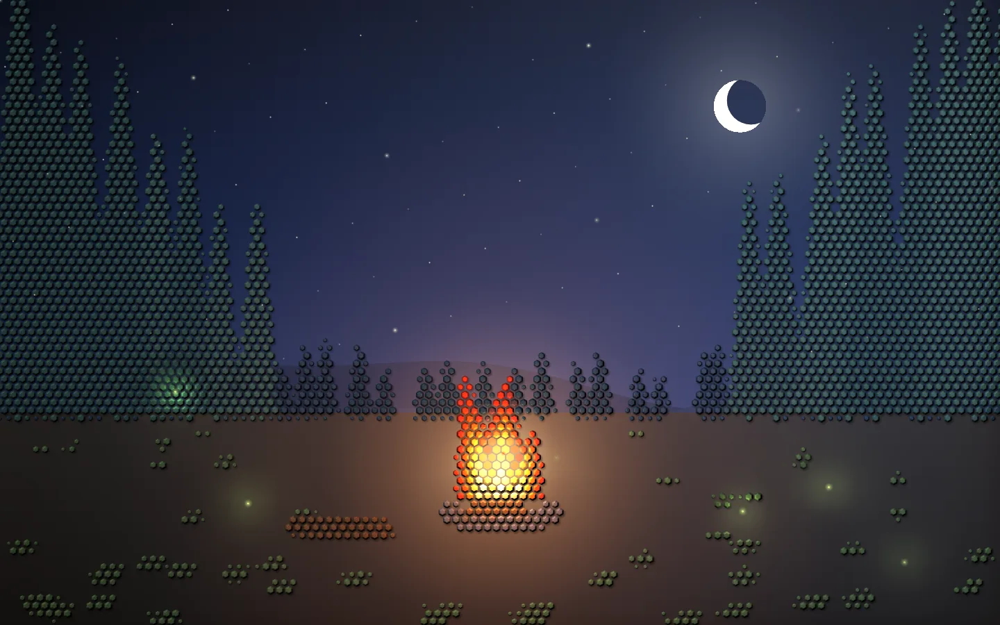 | 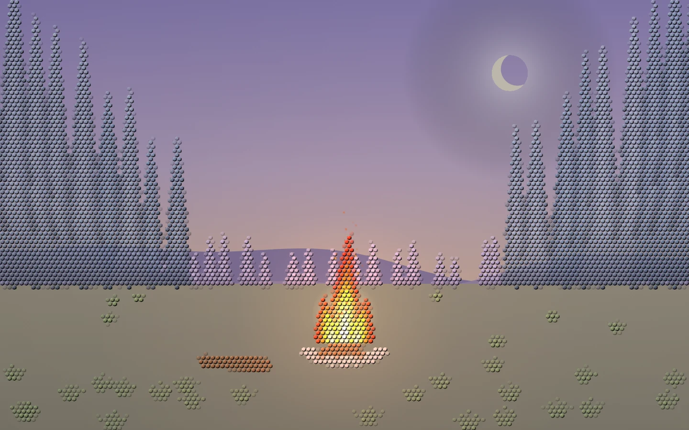 |
| 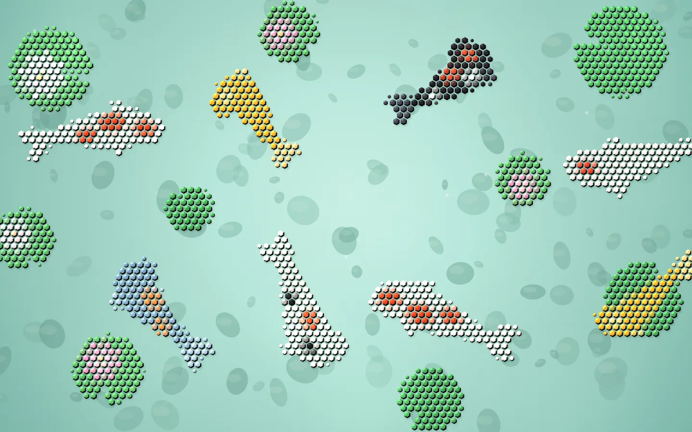 | 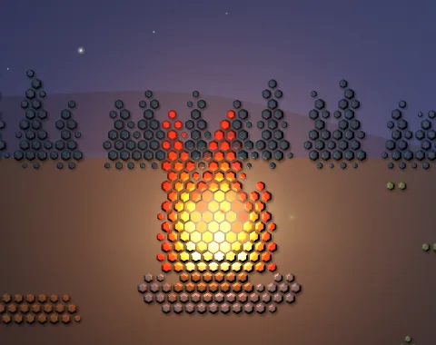 |

And a scene that wants plain illustration has it: Apiary is isometric 2.5D in the `native` style,
its terraces, cottage and hives drawn at full resolution and lit the same way.

| Apiary by day | Apiary by night |
|---|---|
| 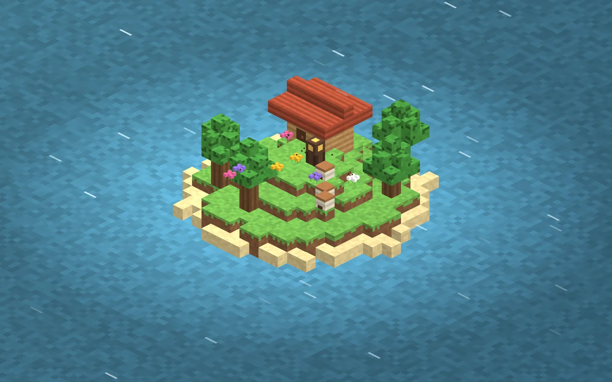 | 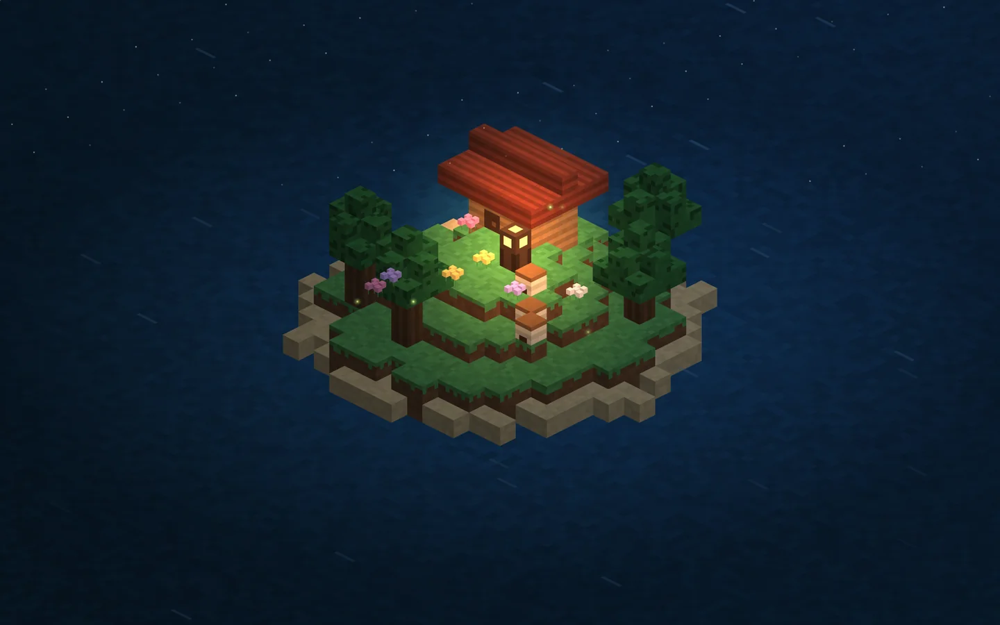 |

Every scene can also be drawn in **ascii**, the way a terminal draws: each cell is read as a
shape, so a fish's flank gets `(` and `)`, its belly `,` and `_`, a reed `|`, and its body is
blocks of its colour with characters cut into them, dense in shadow and sparse in light.

| Koi Pond in ascii | Up close |
|---|---|
| 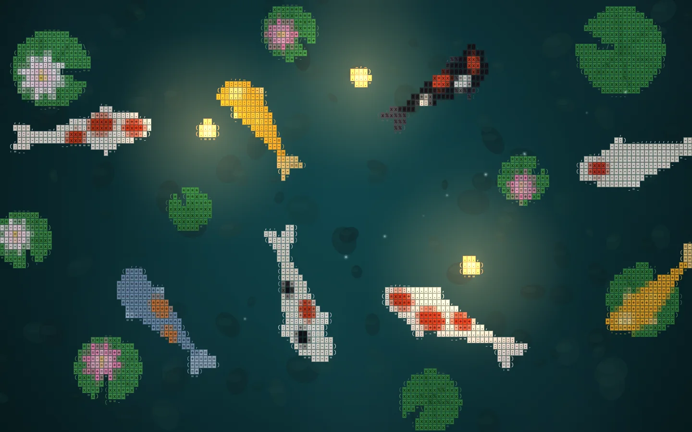 | 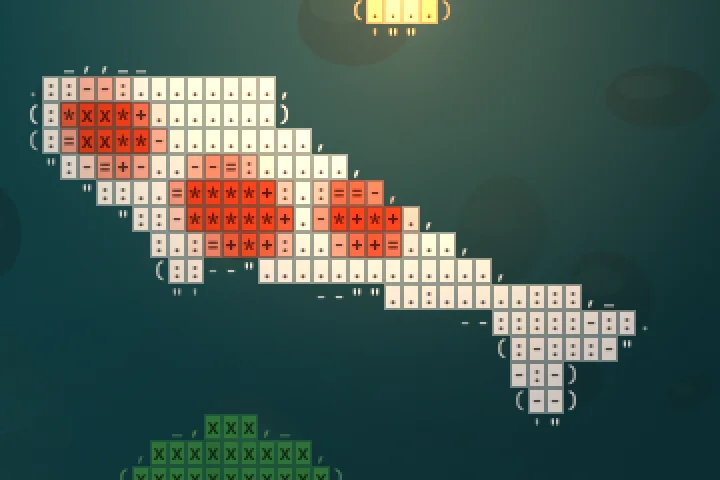 |
| 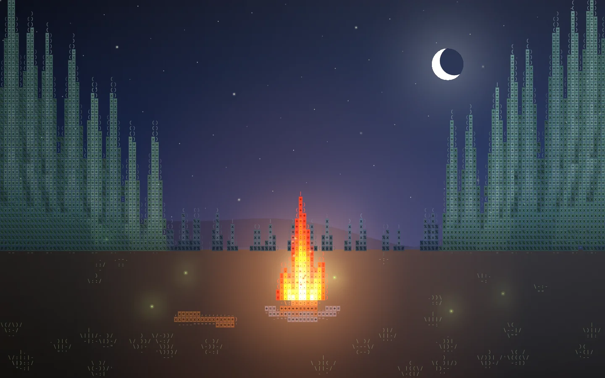 | 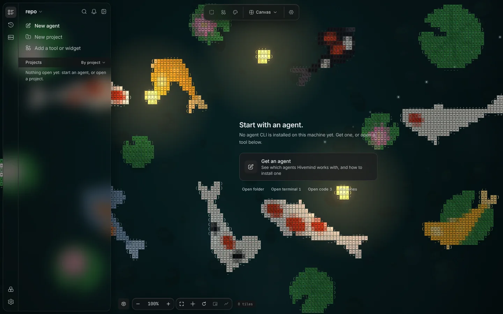 |

## Living pictures

A photograph or a painting, made to move the way a camera moving through it would, in the **ink**
style. The picture is cut into layers by how far each part is, and a slow camera orbits it: near
things slide across far ones, the picture breathes in and out, it leans a little toward the pointer,
and what is far from the focus goes soft. Water and cloud flow where the picture has them. Under a
fixed grid of characters the picture keeps moving, so every character keeps changing and the frame
seems to pour.

| Gèdres (a photograph, 1853) | Sudden Shower (Japan, 1857) |
|---|---|
| 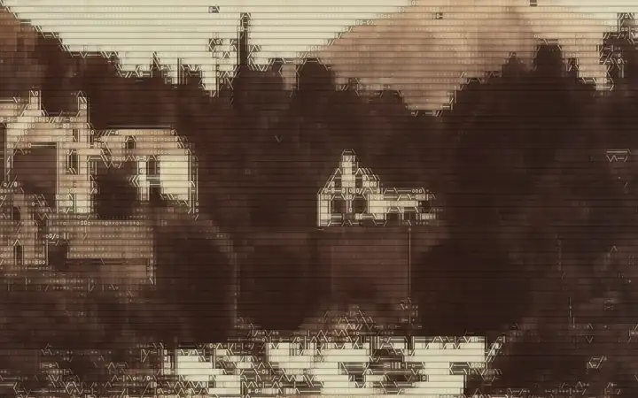 | 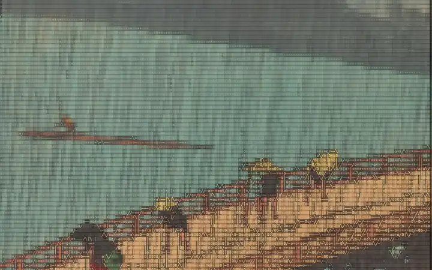 |
| **Lakshmi (India, 1883)** | **The Harvest (Flanders, 1565)** |
| 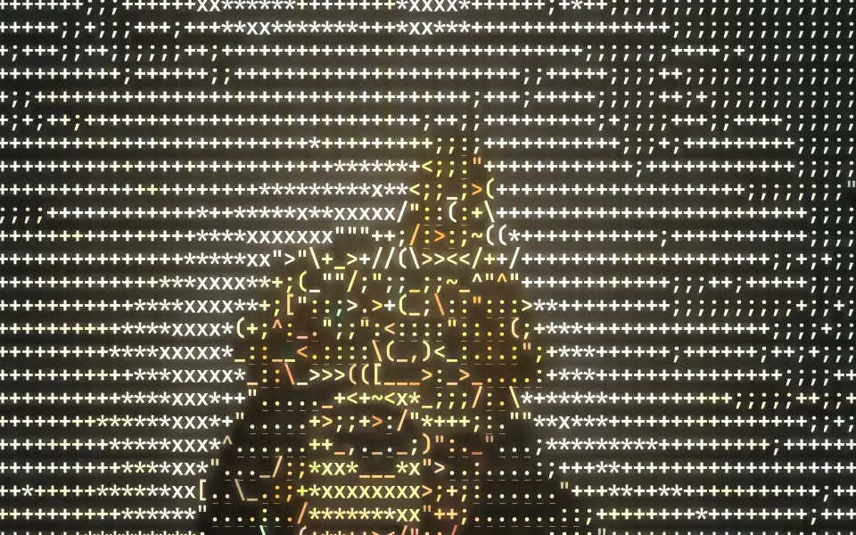 | 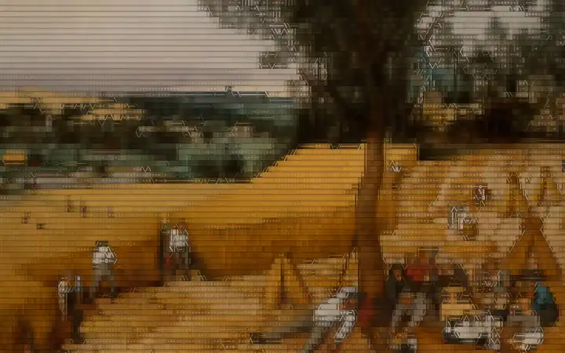 |

Each cell is a block of the picture's own colour with a character in a brighter shade over it.
Where the picture is flat (a sky, paper) the cell keeps near its colour with a faint character, so
the picture reads from across the room; where it has detail the ground darkens and the character
brightens, so the characters draw the brushwork. Outlines become lines that join from cell to cell
(`─ │ ╱ ╲`), and a seam under each row gives a screen's scan lines.

| Mountain Mist (China, 1898), still | Lakshmi by day | Up close |
|---|---|---|
| 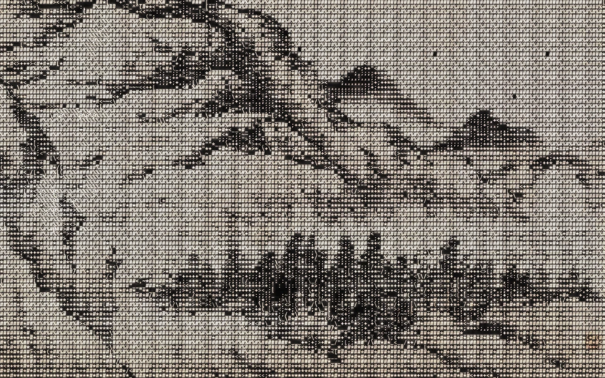 | 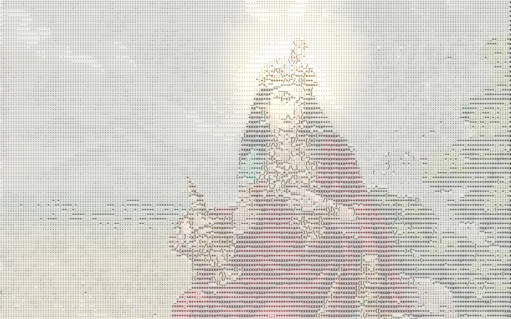 | 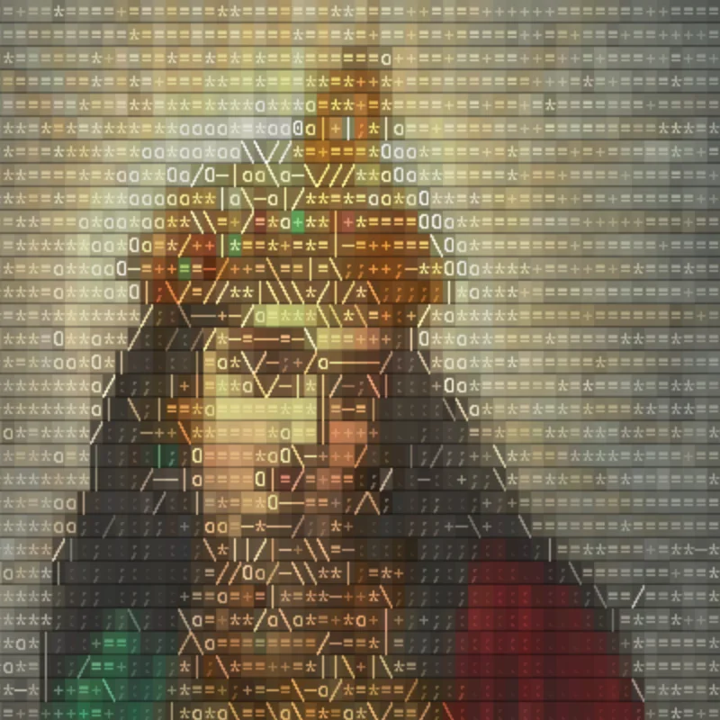 |

A picture is a scene in a few lines: where it is near and far, and what moves.

```ts
import { defineMasterwork } from "@hivescape/paintings";
import image from "./painting.jpg"; // bundled into the wallpaper: it fetches nothing

export default defineMasterwork({
  id: "gedres",
  name: "Gèdres",
  description: "A village in the Pyrenees, its river pouring over the rapids.",
  image,
  levels: 0.6,                                    // a faded print, its tones stretched back
  depth: {
    horizon: 0.655, far: 0.45, near: 1,           // the ground, from the bridge's foot to the viewer
    shapes: [                                      // things standing up, the nearest last
      { poly: [[0, 0], [0.4, 0.13], [1, 0.1], [1, 0.66], [0, 0.66]], z: 0.3 },        // the wooded valley
      { poly: [[0.42, 0.38], [0.66, 0.38], [0.75, 0.7], [0.4, 0.7]], z: 0.48 },        // the hotel and the bridge
    ],
  },
  sharp: { depth: 0.6, range: 0.3, blur: 2.5 },  // the far mountain goes soft
  effects: [
    { kind: "flow", region: [[0.29, 0.72], [0.72, 0.71], [0.75, 0.82], [0.3, 0.86]], dir: [0.12, 1], speed: 0.012 },
  ],
});
```

Everything is placed in the picture's own fractions, so it holds whatever the screen's shape. The
effects are `flow` (water, cloud), `wind`, `rain`, `mist`, `birds`, `fall` (petals, leaves, snow)
and `glow`. The credit goes in the scene's `package.json` (`hivescape.credit`) and `pack` puts it
beside the wallpaper. `film` records a scene moving, every frame at its own time, to review it (or
to show it): `node packages/cli/bin/hivescape.mjs film scenes/gedres --backend webgl2 --webp`. The
`hivescape-living-picture` skill teaches an agent to do all of it from any picture you give it.

The five pictures are from [The Metropolitan Museum of Art's Open Access](https://www.metmuseum.org/about-the-met/policies-and-documents/open-access)
collection, public domain and released under CC0:

| Scene | Picture |
|---|---|
| Gèdres | Joseph Vigier, *Village de Gèdres, Route de Gavarnie*, 1853, salted paper print (2005.100.503.10) |
| Lakshmi | *Lakshmi*, Calcutta Art Studio, Kolkata, 1883 (2021.202) |
| Sudden Shower | Utagawa Hiroshige, *Sudden Shower over Shin-Ōhashi Bridge and Atake*, 1857 (JP2522) |
| Mountain Mist | Song Nian, *Landscape* (a section), 1898 (1986.267.76) |
| The Harvest | Pieter Bruegel the Elder, *The Harvesters*, 1565 (19.164) |

## Your agents, as creatures

A scene can show the person's agents: Hivemind tells it each agent (its program, what it is doing)
and where their tiles are, and the scene draws a creature for each. **The Hive** is the first:

- each agent is a bee, its species from its program (honey bee, bumblebee, carpenter bee, orchid bee);
- working, it flies out over open canvas and back to its cells; ready, it walks the comb; resting,
  it is tucked into a cell;
- when its agent **needs you**, it flies to that agent's tile and does the waggle dance beside it,
  ringed and glowing in the theme's attention colour;
- every turn its agent finishes well fills another of its cells with honey, so over a session the
  comb shows the work done;
- point at a bee and Hivemind names its agent; click it and you are at the agent's tile.

| The dance | Day | In Hivemind, naming the agent under the pointer |
|---|---|---|
| 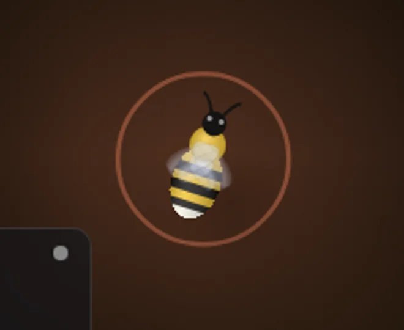 | 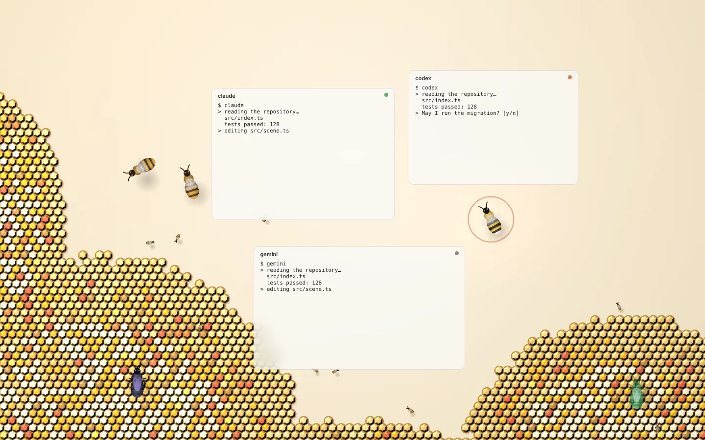 | 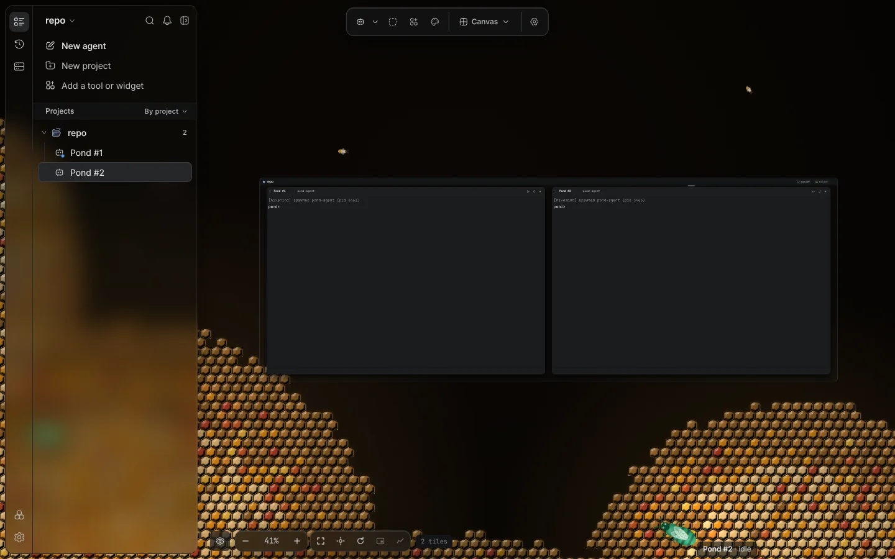 |

**Garden of the day** is the second: beds along the bottom, a plot for each agent, bare each
morning. Every turn an agent finishes grows a plant in its plot (its flower by its program: tulip,
poppy, sunflower, lavender), so by evening the beds are the day's work. Each agent is a garden bird
(robin, blue tit, goldfinch, wren): it hops about its plot at work, sits on its stake when ready,
sleeps there when resting, and when its agent needs you it flies to that agent's tile, **perches on
the tile's top edge** and sings, while the flowers in its plot slowly wilt until you answer.

| Day | Night | Perched on the tile, singing |
|---|---|---|
| 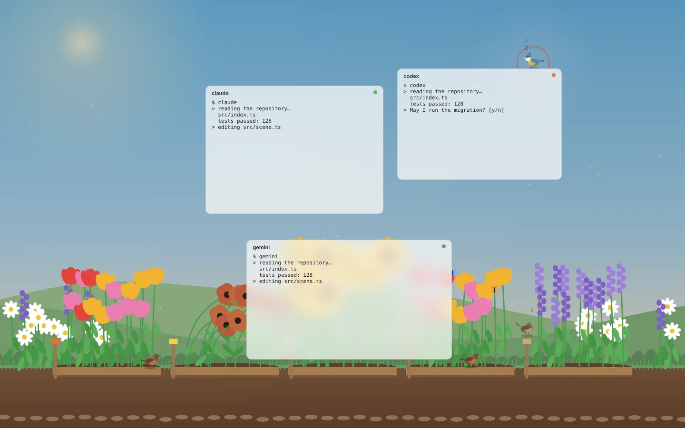 | 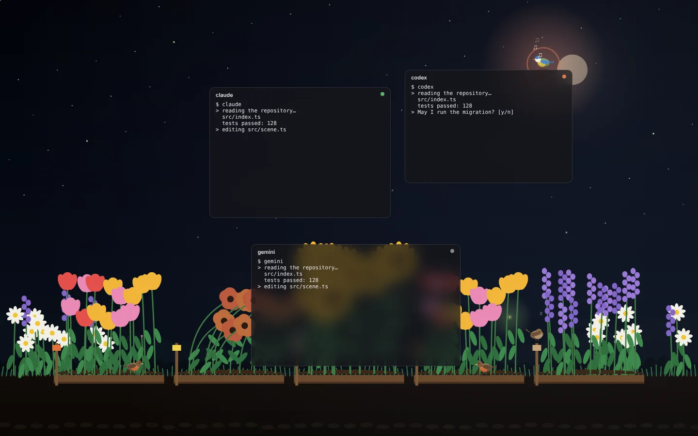 | 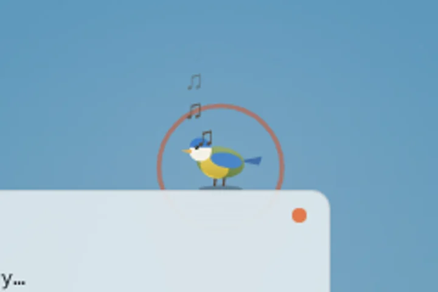 |

In the comb style each wax cell is one of the renderer's own hexagons, so the comb is in relief and
lit, while the bees are drawn crisp on the front layer over it. In ascii the comb is cells walled
in `/ \ _ |` and the bees are characters too.

## What a scene can be

- **Any view.** Top-down (Koi Pond, The Hive), side-on (Campfire, in layers that part as the pointer
  moves; Garden of the day), or isometric (Apiary). `isometric()` maps ground tiles and heights to the screen and back, so the pointer
  lands on the tile under it. `parallax()` shifts a side view's layers by their distance.
- **Any style.** The same scene can be shown as:

  | Style | What it draws |
  |---|---|
  | `comb` | Lit hexagonal cells in relief. The default. |
  | `ascii` | Character cells, as a terminal draws them: a body is a block with a character cut into it, an edge the light character that sits where the shape does (`. , ' ( )`), a thin stroke a line character along it (`- \| / \`). |
  | `pixel` | Square cells, flat or in relief. |
  | `native` | The picture itself at full resolution, lit and glowing: plain 2D illustration. |
  | `ink` | The whole frame in characters, as an ASCII shader draws: each cell its colour, a character in a brighter shade over it, lines along edges. Made for paintings and photographs. |

- **Lit.** `light()` paints what glows. Each cell is shaded from the direction its light comes
  from, a cell inside strong light shines on its own, and the light glows over the ground.
- **Alive, not busy.** The clock steps at a fixed 60 Hz and draws at most 30 frames a second. A
  scene can run, hold, or settle to a still frame. Randomness is seeded, so the same seed draws the
  same scene.

## Quick start

```bash
pnpm install
pnpm dev                                     # Koi Pond at http://127.0.0.1:5174/ (?look=light, ?kind=ascii, ?backend=canvas2d)
node packages/cli/bin/hivescape.mjs shot scenes/campfire --kind comb,native   # pictures and a contact sheet, dark and light
node packages/cli/bin/hivescape.mjs film scenes/gedres --webp                 # an MP4 (and WebP) of it moving
node packages/cli/bin/hivescape.mjs bench scenes/koi                          # time per frame, per backend and style
pnpm test                                    # unit and scene tests
```

## A scene

```ts
import { defineScene, TAU } from "@hivescape/core";

export default defineScene({
  id: "lamp",
  name: "Lamp",
  style: (look) => ({ kind: "comb", cell: [16, 0], ambient: look.dark ? 0.45 : 1 }),
  create: (w) => ({ x: w.size.w / 2, y: w.size.h / 2 }),
  step(s, dt, w) { if (w.input.pointer.active) { s.x += (w.input.pointer.x - s.x) * dt; s.y += (w.input.pointer.y - s.y) * dt; } },
  backdrop(_s, g, w) { g.fillStyle = w.look.dark ? "#101418" : "#eef0f2"; g.fillRect(0, 0, w.size.w, w.size.h); },
  picture(s, g) { g.fillStyle = "#c9a36a"; g.beginPath(); g.arc(s.x, s.y, 90, 0, TAU); g.fill(); },
  light(s, g) {
    const r = g.createRadialGradient(s.x - 160, s.y - 120, 0, s.x - 160, s.y - 120, 320);
    r.addColorStop(0, "rgba(255,190,110,0.9)"); r.addColorStop(1, "rgba(255,190,110,0)");
    g.fillStyle = r; g.fillRect(0, 0, 4000, 4000);
  },
});
```

The full contract is in [`packages/core/src/scene.ts`](packages/core/src/scene.ts):

| Hook | Called |
|---|---|
| `create` | once, to build the scene |
| `step` | on every fixed step |
| `backdrop` | rarely: when the size or the look changes |
| `picture` | every frame |
| `light` | every frame |
| `overlay` | every frame: exact characters and soft dots |
| `front` | every frame: creatures at full resolution over the cells |
| `spots` | after each frame: where each agent's creature is, for hover and click |
| `done` | when an agent finishes a turn well |
| `click`, `resize`, `settle` | when they happen |

## In Hivemind

Every scene can be a [Hivemind](https://github.com/dip497/hivemind) live wallpaper:

```bash
node packages/cli/bin/hivescape.mjs pack scenes/koi      --out out/hivemind --package @you/scenes --name "My scenes"
node packages/cli/bin/hivescape.mjs pack scenes/campfire --out out/hivemind --package @you/scenes
node packages/cli/bin/hivescape.mjs pack scenes/koi      --out out/hivemind --package @you/scenes --kind ascii   # "Koi Pond (ASCII)"
hive plugins check out/hivemind      # runs each wallpaper sandboxed, as the app does
hive plugins install out/hivemind    # the app offers it as your background
```

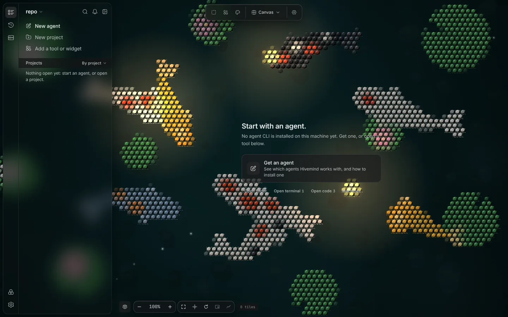

`pack` writes the folder the app needs: the wallpaper's script, built for protocol 1 and running in
a worker; its manifest; a preview picture; and the licences. `@hivescape/hivemind` connects a scene
to the app. It passes on the size, the look (dark or light, and the app's colours), run, hold or
still, and the pointer and clicks over open canvas.

## Skills for agents

`skills/` holds four skills (linked into `.claude/skills` for Claude Code); any agent can read them:

| Skill | Teaches |
|---|---|
| `hivescape-scene` | Designing and writing a scene that is its own, top-down, side-on or isometric. |
| `hivescape-living-picture` | Making a photograph or painting a living scene: depth, camera, flowing water, filming it. |
| `hivescape-review` | The quality bar: contact sheets, what to look for, the cost budget, the tests. |
| `hivescape-hivemind` | Packing scenes as Hivemind wallpapers, checking, installing and publishing them. |

## Packages

| Package | What it is |
|---|---|
| `@hivescape/core` | The scene contract, styles, clock, input, effects, colour (OKLab, OKLCH, WCAG contrast), seeded randomness, flocking, springs, views (isometric, parallax), and `simulate` for tests. No DOM. |
| `@hivescape/render` | The renderer. WebGL2 where there is a GPU: about four draw calls a frame, whatever the cell count, and the picture is never read back. A Canvas2D fallback for everything else. |
| `@hivescape/runtime` | `mount(element, scene)` for a page, and `serveScene(scene)` to run a scene in a worker on an OffscreenCanvas. |
| `@hivescape/hivemind` | The Hivemind live wallpaper adapter. |
| `@hivescape/paintings` | `defineMasterwork`: a photograph or painting as a living scene, in depth layers a camera orbits, with flowing water and other effects. |
| `@hivescape/cli` | `dev`, `shot`, `bench`, `build` and `pack`. |

How it works, and why it is built this way, is in [docs/architecture.md](docs/architecture.md).
What it costs is in [docs/performance.md](docs/performance.md).

## Licence

MIT. The bundled JetBrains Mono (used for the ascii and ink styles) is under the SIL Open Font
License; see `packages/render/fonts/OFL.txt`. The pictures in `scenes/gedres`, `scenes/lakshmi`,
`scenes/sudden-shower`, `scenes/mountain-mist` and `scenes/harvest` are public domain (The Met, CC0);
each scene's `package.json` credits its own.
