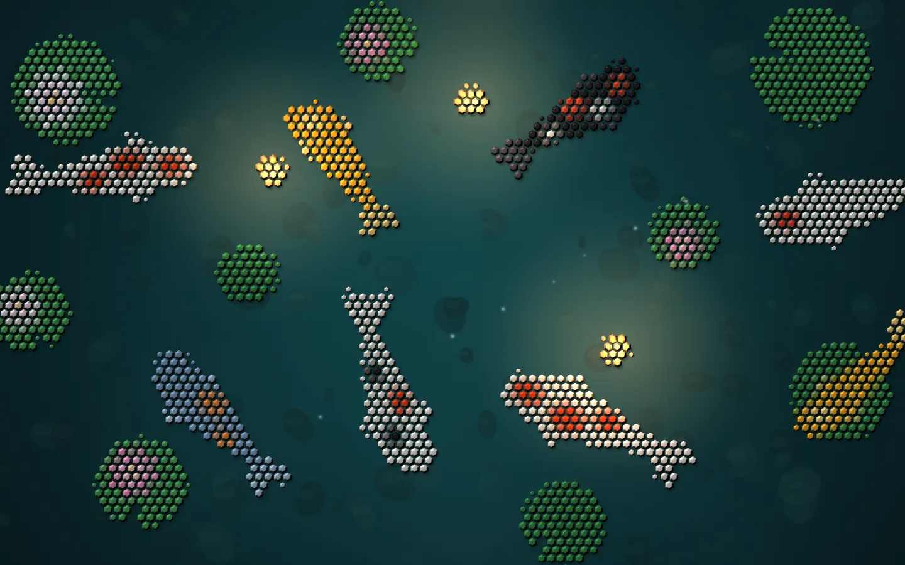

# Hivescape

Living backgrounds that stay out of the way. From the Hivemind family.



Hivescape is an animation engine for scenes that run behind other things: a desktop, a terminal
canvas, a web page. A scene paints what is there in plain canvas calls and says what gives off
light. Hivescape shows it in a style of your choosing, lights it, moves it at a calm, fixed rate,
and keeps its cost low enough to run all day.

Its own style is **comb**: the picture becomes a honeycomb of raised hexagonal cells, each bevelled
and lit. Three lights shade the cells:

- a key light from the upper left;
- the scene's own lights (a fire, a lantern, the moon), from the side each one shines from;
- the pointer, which works as a torch you move across the relief.

A click sends a swell through the cells and lifts them as it passes.

| Night | Dusk |
|---|---|
|  |  |
|  |  |

And a scene that wants plain illustration has it: Apiary is isometric 2.5D in the `native` style,
its terraces, cottage and hives drawn at full resolution and lit the same way.

| Apiary by day | Apiary by night |
|---|---|
|  |  |

Every scene can also be drawn in **ascii**, the way a terminal draws: each cell is read as a
shape, so a fish's flank gets `(` and `)`, its belly `,` and `_`, a reed `|`, and its body is
blocks of its colour with characters cut into them, dense in shadow and sparse in light.

| Koi Pond in ascii | Up close |
|---|---|
|  |  |
|  |  |

## What a scene can be

- **Any view.** Top-down (Koi Pond), side-on in layers that part as the pointer moves (Campfire),
  or isometric (Apiary). `isometric()` maps ground tiles and heights to the screen and back, so the pointer
  lands on the tile under it. `parallax()` shifts a side view's layers by their distance.
- **Any style.** The same scene can be shown as:

  | Style | What it draws |
  |---|---|
  | `comb` | Lit hexagonal cells in relief. The default. |
  | `ascii` | Character cells, as a terminal draws them: a body is a block with a character cut into it, an edge the light character that sits where the shape does (`. , ' ( )`), a thin stroke a line character along it (`- \| / \`). |
  | `pixel` | Square cells, flat or in relief. |
  | `native` | The picture itself at full resolution, lit and glowing: plain 2D illustration. |

- **Lit.** `light()` paints what glows. Each cell is shaded from the direction its light comes
  from, a cell inside strong light shines on its own, and the light glows over the ground.
- **Alive, not busy.** The clock steps at a fixed 60 Hz and draws at most 30 frames a second. A
  scene can run, hold, or settle to a still frame. Randomness is seeded, so the same seed draws the
  same scene.

## Quick start

```bash
pnpm install
pnpm dev                                     # Koi Pond at http://127.0.0.1:5174/ (?look=light, ?kind=ascii, ?backend=canvas2d)
node packages/cli/bin/hivescape.mjs shot scenes/campfire --kind comb,native   # pictures and a contact sheet, dark and light
node packages/cli/bin/hivescape.mjs bench scenes/koi                          # time per frame, per backend and style
pnpm test                                    # unit and scene tests
```

## A scene

```ts
import { defineScene, TAU } from "@hivescape/core";

export default defineScene({
  id: "lamp",
  name: "Lamp",
  style: (look) => ({ kind: "comb", cell: [16, 0], ambient: look.dark ? 0.45 : 1 }),
  create: (w) => ({ x: w.size.w / 2, y: w.size.h / 2 }),
  step(s, dt, w) { if (w.input.pointer.active) { s.x += (w.input.pointer.x - s.x) * dt; s.y += (w.input.pointer.y - s.y) * dt; } },
  backdrop(_s, g, w) { g.fillStyle = w.look.dark ? "#101418" : "#eef0f2"; g.fillRect(0, 0, w.size.w, w.size.h); },
  picture(s, g) { g.fillStyle = "#c9a36a"; g.beginPath(); g.arc(s.x, s.y, 90, 0, TAU); g.fill(); },
  light(s, g) {
    const r = g.createRadialGradient(s.x - 160, s.y - 120, 0, s.x - 160, s.y - 120, 320);
    r.addColorStop(0, "rgba(255,190,110,0.9)"); r.addColorStop(1, "rgba(255,190,110,0)");
    g.fillStyle = r; g.fillRect(0, 0, 4000, 4000);
  },
});
```

The full contract is in [`packages/core/src/scene.ts`](packages/core/src/scene.ts):

| Hook | Called |
|---|---|
| `create` | once, to build the scene |
| `step` | on every fixed step |
| `backdrop` | rarely: when the size or the look changes |
| `picture` | every frame |
| `light` | every frame |
| `overlay` | every frame: exact characters and soft dots |
| `click`, `resize`, `settle` | when they happen |

## In Hivemind

Every scene can be a [Hivemind](https://github.com/dip497/hivemind) live wallpaper:

```bash
node packages/cli/bin/hivescape.mjs pack scenes/koi      --out out/hivemind --package @you/scenes --name "My scenes"
node packages/cli/bin/hivescape.mjs pack scenes/campfire --out out/hivemind --package @you/scenes
node packages/cli/bin/hivescape.mjs pack scenes/koi      --out out/hivemind --package @you/scenes --kind ascii   # "Koi Pond (ASCII)"
hive plugins check out/hivemind      # runs each wallpaper sandboxed, as the app does
hive plugins install out/hivemind    # the app offers it as your background
```


`pack` writes the folder the app needs: the wallpaper's script, built for protocol 1 and running in
a worker; its manifest; a preview picture; and the licences. `@hivescape/hivemind` connects a scene
to the app. It passes on the size, the look (dark or light, and the app's colours), run, hold or
still, and the pointer and clicks over open canvas.

## Skills for agents

`skills/` holds three skills (linked into `.claude/skills` for Claude Code); any agent can read them:

| Skill | Teaches |
|---|---|
| `hivescape-scene` | Designing and writing a scene that is its own, top-down, side-on or isometric. |
| `hivescape-review` | The quality bar: contact sheets, what to look for, the cost budget, the tests. |
| `hivescape-hivemind` | Packing scenes as Hivemind wallpapers, checking, installing and publishing them. |

## Packages

| Package | What it is |
|---|---|
| `@hivescape/core` | The scene contract, styles, clock, input, effects, colour (OKLab, OKLCH, WCAG contrast), seeded randomness, flocking, springs, views (isometric, parallax), and `simulate` for tests. No DOM. |
| `@hivescape/render` | The renderer. WebGL2 where there is a GPU: about four draw calls a frame, whatever the cell count, and the picture is never read back. A Canvas2D fallback for everything else. |
| `@hivescape/runtime` | `mount(element, scene)` for a page, and `serveScene(scene)` to run a scene in a worker on an OffscreenCanvas. |
| `@hivescape/hivemind` | The Hivemind live wallpaper adapter. |
| `@hivescape/cli` | `dev`, `shot`, `bench`, `build` and `pack`. |

How it works, and why it is built this way, is in [docs/architecture.md](docs/architecture.md).
What it costs is in [docs/performance.md](docs/performance.md).

## Licence

MIT. The bundled JetBrains Mono (used for the ascii style) is under the SIL Open Font License; see
`packages/render/fonts/OFL.txt`.
